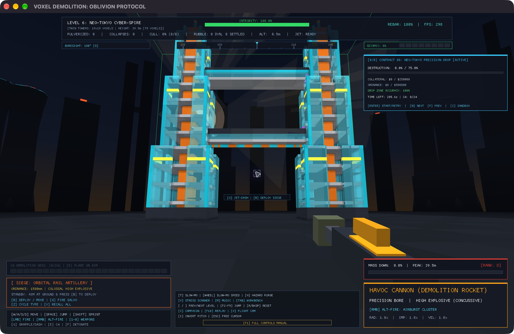
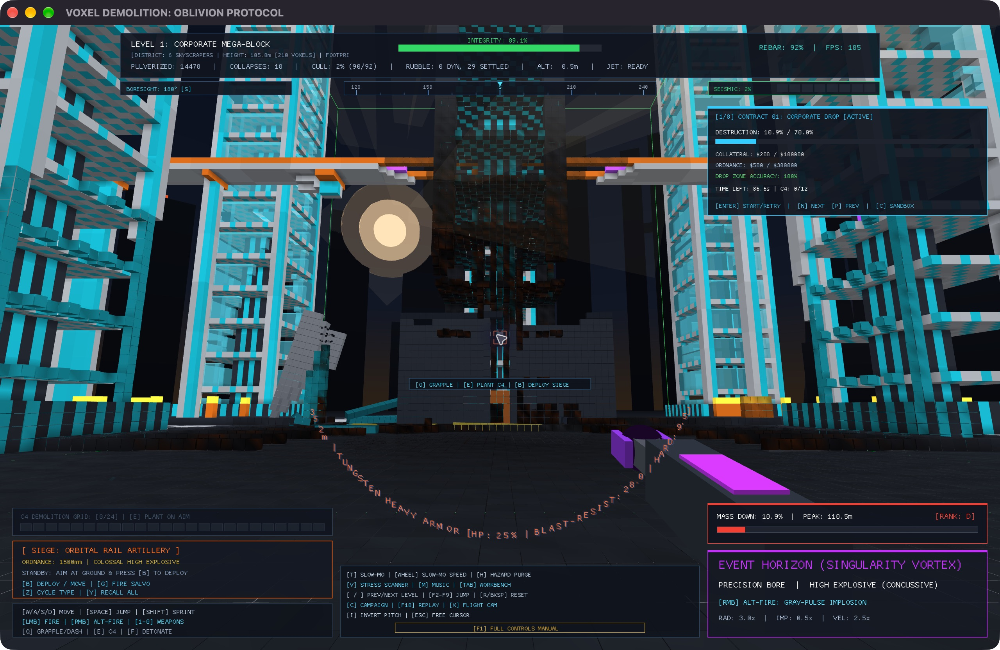
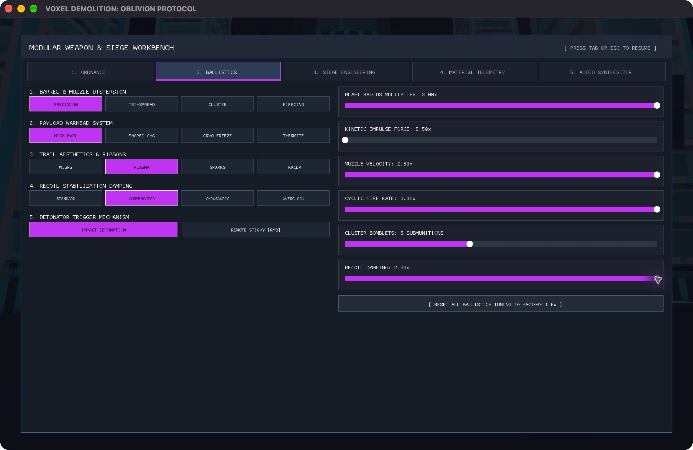

# Voxel Demolition: Oblivion Protocol

**Tiny download. Big collapses.**

A first-person demolition sandbox in a **~5.5 MB macOS download**, including
the illustrated 25-page manual. The signed game executable is **~1.7 MB**.
Explore nine procedural districts, pick from ten weapons, and turn a carefully
chosen cut into a falling skyline.

**[Download 0.2.5 for Apple Silicon](https://github.com/steph4n-gh/voxel-demolition/releases/download/v0.2.5/voxel-demolition-0.2.5-aarch64-apple-darwin-notarized.zip)**
· [Player manual (PDF)](https://github.com/steph4n-gh/voxel-demolition/releases/download/v0.2.5/Voxel-Demolition-Player-Manual.pdf)
· [ZIP checksum](https://github.com/steph4n-gh/voxel-demolition/releases/download/v0.2.5/voxel-demolition-0.2.5-aarch64-apple-darwin-notarized-SHA256SUMS.txt)
· [Release notes](https://github.com/steph4n-gh/voxel-demolition/releases/tag/v0.2.5)

Ready to play? Follow the [installation and first-play steps](#play). The download
above contains the macOS app; GitHub's **Source code** archives are for building
the game yourself.



*Neo Tokyo's twin towers: one of nine districts generated by the game.*

- **Choose the cut.** Ten weapon chassis, linked C4 charges, and four siege
  platforms give you different ways to breach, slice, blast, and collapse.
- **Watch the structure react.** Severed supports release detached voxel
  structures into falling, rotating rubble. Excavated terrain and volatile
  materials can change what happens next.
- **Make it count.** Eight demolition contracts put destruction, spending, time,
  and precision limits on your work. Corporate Drop rewards a controlled landing.
- **Experiment.** Tune weapons in the workbench, use slow motion, and inspect
  recorded action with the replay camera.

<table>
  <tr>
    <td width="50%"></td>
    <td width="50%"></td>
  </tr>
  <tr>
    <td>Corporate Drop after a breach. Destruction, spending, and collateral all matter.</td>
    <td>Tune blast radius, impulse, velocity, cadence, and recoil before the next cut.</td>
  </tr>
</table>

*Actual gameplay captures; [artwork provenance](docs/manual-assets/README.md)
records the capture version.*

## Engineering highlights

**A city built from materials. A soundtrack built from signals. Collapses you
can inspect.** The small executable contains the rules for building and breaking
the world: custom simulation, mesh generation, and audio synthesis in Rust, with
Macroquad providing windowing, rendering, audio playback, and the embedded font.

- **A grid with 10,027,008 cells.** A 192 × 272 × 192 grid at 0.5 m resolution
  stores materials and their remaining health, including excavatable ground.
  Nine districts are constructed from code-defined foundations, slabs, cores,
  columns, facades, and volatile installations.
- **Geometry becomes physics.** Support and connectivity analysis extracts
  detached voxel islands into moving bodies. Their materials and damage survive
  the handoff; rotating rubble remains hittable, damageable, and fracturable.
  The wire-saw can cut both standing structures and already-falling pieces.
- **Destruction changes the renderer.** Dirty 8 × 8 × 8 chunks rebuild as the
  world changes. Compatible intact faces merge into larger quads; damaged faces
  retain local detail. Reused buffers and mesh storage reduce repeated work.
- **Sound is generated content.** Thirty synthesized effects and a four-layer
  dark-synth score are generated in memory at startup. Gameplay selects calm,
  intense, and slow-motion music loops as demolition unfolds.
- **The systems close the loop.** Slag damages material, water quenches slag,
  and cooled slag can form basalt. Precision contracts wait for rubble to settle
  and check transformed voxel positions at landing-zone boundaries. Replay and
  the workbench pause live simulation so inspection does not advance a contract.

Read **[Inside Voxel Demolition: the engineering](docs/README.md)** for the
algorithms, source pointers, performance measurements, and the choices that make
these systems work together.

### Small enough to share

| Measured 0.2.5 Apple Silicon package | Size |
| --- | ---: |
| Signed game executable | 1,703,984 bytes (~1.7 MB) |
| Complete notarized ZIP, including the manual and license notices | 5,483,392 bytes (~5.5 MB) |

The release uses LTO, stripped symbols, and speed optimization. Paired simulation
and meshing measurements informed the choice of build;
[the release guide](docs/release.md#one-build-chosen-by-measurement) has the
workloads, results, and their limits. These sizes describe the download and
executable; the simulation's working memory is separate.

## Play

1. Download the **Apple Silicon macOS ZIP** linked above.
2. Double-click the ZIP to expand it, then open the extracted folder.
3. Move **Voxel Demolition.app** to **Applications** and open it. Confirm the
   normal first-launch prompt if macOS asks.

The app is signed with Developer ID, notarized by Apple, and stapled.
Apple Silicon macOS is the qualified platform for 0.2.5; native checks used an
Apple M4 Pro running macOS 27. Other platforms and macOS versions need their own
build and gameplay checks.

The game starts in sandbox mode, without a contract deadline. Move with
`W/A/S/D` and look with the mouse, choose a weapon with `1` through `0`, and fire
with the left mouse button. `F1` opens help, `Tab` opens the workbench, `R` resets
the district, and `Esc` releases the cursor and pauses; press it again to resume.
Press `C` when you want to start a campaign contract. If function keys change
brightness or volume, hold **Fn** or **Globe** while pressing them.

To check the ZIP, download its checksum beside it and run this in the folder
containing both files:

```sh
shasum -a 256 -c voxel-demolition-0.2.5-aarch64-apple-darwin-notarized-SHA256SUMS.txt
```

The result should end in `OK`. Installation troubleshooting is in
[the manual](docs/manual.md#12-installation-session-state-and-troubleshooting).

The [player manual](docs/manual.md) covers every control, weapon, level, contract,
workbench setting, and replay control. The workbench, help, free cursor, and
replay pause the live world and contract timer. Settings and the current contract
attempt are kept in memory during the session; there is no autosave or persistent
campaign history.

## Build

From a source checkout, install a stable Rust toolchain and use the pinned
dependencies. On macOS, also install Xcode's command-line tools. See the
[developer notes](docs/development.md) for Linux build prerequisites.

```sh
cargo build --locked --release
cargo run --locked --release
```

Add `--offline` when Cargo's dependency cache is populated. Build output goes to
`target_cli/`; the standalone executable is
`target_cli/release/voxel_demolition` (`.exe` on Windows). Set `CARGO_TARGET_DIR`
to another directory if needed.

## Development and releases

- [CI checks](.github/workflows/ci.yml): tests, Clippy, the manual, and an ad hoc
  macOS candidate on GitHub-hosted Apple Silicon runners.
- [Contributing](CONTRIBUTING.md): focused fixes, checks, and contribution terms.
- [Developer notes](docs/development.md): source layout, simulation invariants,
  and test guidance.
- [Release guide](docs/release.md): verification, packaging, macOS signing and
  notarization, and qualification limits.
- [Changelog](CHANGELOG.md): changes by version.

## License

Licensed under **MIT OR Apache-2.0**; see [LICENSE-MIT](LICENSE-MIT) and
[LICENSE-APACHE](LICENSE-APACHE). Dependency and embedded-font attributions are
listed in [THIRD_PARTY_NOTICES.md](THIRD_PARTY_NOTICES.md) and included with release
packages.
