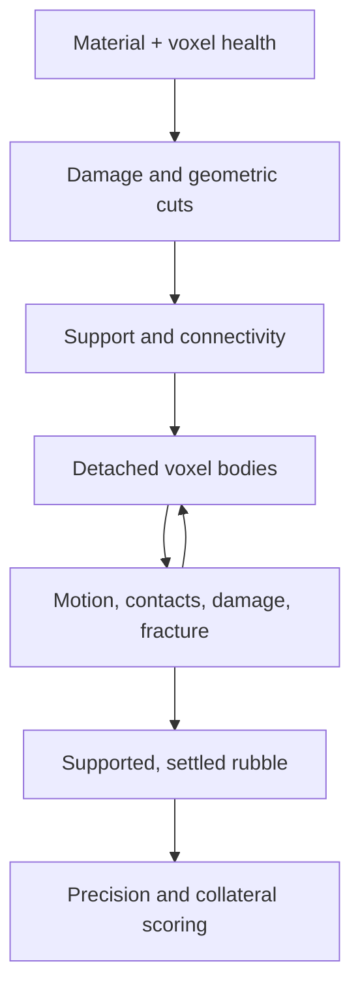

# Inside Voxel Demolition

**A city built from materials. A soundtrack built from signals. Collapses you
can inspect.**

Voxel Demolition fits a native first-person game, nine generated districts, ten
weapons, four siege platforms, and eight contracts into a **1.70 MB signed
executable**. The complete **5.48 MB macOS download** includes the illustrated
25-page manual and license notices. Those are the measured sizes of the 0.2.4
Apple Silicon release.

The engineering accomplishment is making the systems agree about the world.
A shot changes material health and geometry. That changes support. A detached
section becomes moving rubble, carrying its surviving material and damage with
it. The next shot can hit that rubble, and a precision contract can judge where
it eventually lands.

## Build the world from rules

The world has **10,027,008 addressable voxel cells**: 192 × 272 × 192, at 0.5 m
resolution. Its vertical range extends 24 m underground and 112 m above ground.
Material IDs and health occupy separate contiguous arrays. Empty cells are part
of that capacity; the count describes the grid, not ten million occupied blocks
being drawn or updated individually each frame. The world and its working
buffers are created in memory at runtime.

District builders assemble foundations, floor slabs, hollow cores, perimeter
columns, facades, and material-specific installations. The nine districts are
authored procedural constructions with their own layouts and character. Distant
skyline geometry is generated too. Geometry, sound effects, and music are
represented by construction rules rather than a separate game asset pack.
Macroquad supplies the platform services and bundled font.

Explore [the grid and material definitions](../src/voxel.rs#L4),
[district generation](../src/world_gen.rs#L294), and
[building construction](../src/world_gen.rs#L732).

## Let the geometry become the physics

Materials respond differently to kinetic, explosive, thermal, cryogenic, and
concussive damage. The same damage rules apply to standing structures and
detached rubble. Cutting a support changes the connectivity problem: support
analysis identifies detached islands, and the frame loop hands them to the
custom physics system as voxel bodies.

Support propagation follows grounding, anchored rebar tension, and limited
cantilever reach through an 18-neighbor neighborhood. Structural dirty bounds
localize the work; checks expand when support paths or connected components
cross the local region. This lets a cut change the fate of an entire connected
section while focusing routine work on the part of the world that changed.

Surviving health carries across detachment, cutting, and fracture. Removing
voxels from a moving body updates its shape and mass; recentering the survivors
preserves their world positions and point velocities. Hit tests transform rays
into a body's local coordinates and test voxel boxes, so a rotated fragment's
actual occupied cells and gaps matter.

Rubble has both linear and angular motion. The contact solver uses an
approximate inertia tensor and the contact-point velocity `v + ω × r` to apply
normal and friction impulses. An off-center impact can change a body's spin.
Crushing can remove yielded floor material and add some of its mass to the
falling body; fracture distributes the parent's accounted mass among children,
including mass acquired through crushing. Settlement requires support as well
as slow motion, and body collisions trigger a final support recheck before a
piece can sleep.

That makes different weapons operations on shared state. A railgun bores a
cylinder; the wire-saw cuts a plane through standing voxels and bisects existing
rubble. Moving volatile materials can trigger further reactions at their current
positions. These are gameplay models of material response, support, and contact;
inertia, fracture, and collision handling use approximations for interactive play.

Explore [shared material response](../src/voxel.rs#L66),
[support analysis](../src/voxel.rs#L1615),
[damage-preserving detachment](../src/physics.rs#L1988),
[moving-body damage](../src/physics.rs#L1639),
[contact impulses](../src/physics.rs#L702),
[mass-preserving fracture](../src/physics.rs#L1230),
[rotation-aware hits](../src/physics.rs#L5393), and
[wire-saw cuts](../src/weapon.rs#L1539).

## Rebuild what changed

The renderer divides the grid into **8 × 8 × 8 chunks**. Mutations mark affected
chunks and their relevant neighbors dirty, including partial damage that changes
appearance. Empty chunks skip geometry generation. For occupied chunks, the
mesher considers exposed faces inside tight occupied bounds, merges compatible
pristine faces into larger quads, and preserves damaged faces as local detail.
Material colors and ambient-occlusion samples help give the generated geometry
its appearance.

Reusable vertex/index scratch buffers and pooled mesh storage reduce repeated
allocation. Meshes are partitioned into bounded batches without splitting
triangles. Static chunk bounds support camera-frustum rejection; moving rubble
renders a cached exposed-voxel shell. The grid also keeps
incremental occupancy counts, so tracking standing structure does not require a
full-grid recount each frame. Resetting the world uses contiguous slice fills
for material and health arrays. Allocation and rebuild costs still exist when
workload sizes grow or geometry changes; these techniques target recurring work.

Explore [dirty-chunk updates](../src/voxel.rs#L939),
[meshing](../src/voxel.rs#L2345),
[frustum rejection](../src/voxel.rs#L2930), and
[contiguous reset](../src/voxel.rs#L763).

## Synthesize the soundtrack

**Thirty sound effects are synthesized in code** using oscillators, noise,
envelopes, filtering, and saturation. Samples are packed into 44.1 kHz, 16-bit
mono WAV data in memory for audio playback.

The music synthesizer mixes four layers: sub-bass, arpeggiated lead, percussion,
and a drone pad. At startup it generates three four-bar loops: calm, intense,
and slow motion. During play, the amount removed from the standing structure
selects the calm or intense loop; slow motion selects its own loop. This is
reactive playback of synthesized music. Waveforms are generated at startup,
rather than continuously recomposed during gameplay.

Explore [sound synthesis](../src/audio.rs#L99),
[PCM/WAV assembly](../src/audio.rs#L47),
[the layered music synthesizer](../src/music.rs#L235), and
[gameplay music selection](../src/music.rs#L400).

## Make inspection and precision part of the simulation

Precision contracts wait for nonempty moving rubble to settle. Chunks entirely
inside or outside a drop zone take a bounds-based path; chunks crossing its
boundary are scored using each surviving voxel's transformed world position.
A chunk's center alone cannot conceal material spilling over the edge. Grading
runs after newly detached islands enter physics, so a new collapse is visible to
the mission before it can declare a win.

Terrain and hazards participate too: molten slag thermally damages material,
water quenches it, cooled slag can form basalt cells, and fire or sparks can
ignite toxic gas. The puzzle is how to remove material and what the remaining
material will do next.

The frame loop separates slowed world time from contract time. Slow motion
changes physics, weapons, siege, and fluid updates; contracts use the unslowed
frame delta. Help, the workbench, free cursor, and replay pause live gameplay.
The replay holds a bounded recent history of player, projectile, and chunk
snapshots and draws recorded proxies over the current terrain. It is an
inspection tool; historical voxel topology is not restored.

Explore [settled-rubble scoring](../src/campaign.rs#L307),
[frame order and timing](../src/main.rs#L1194),
[hazard interactions](../src/fluid.rs#L352), and
[replay proxies](../src/replay.rs#L300).

## Keep it small, then measure the tradeoff

The game uses Rust and one direct dependency, Macroquad. Release builds use
speed optimization, LTO, one codegen unit, stripped symbols, and panic abort.
Generated content keeps the executable compact while the simulation builds its
world in memory.

A historical compiler-profile experiment compared speed optimization
(`opt-level = 3`) with the former size-focused build (`opt-level = "z"`) on
identical workloads. Four measured pairs used balanced AB/BA ordering after a
full-process warmup for each profile, on an Apple M4 Pro running macOS 27.

| Headless CPU workload | Retained build median | Former size-focused median | Paired median speedup |
| --- | ---: | ---: | ---: |
| 20 full-grid clears | 14.968 ms | 126.709 ms | 8.46× |
| Generated district and mesh rebuild | 61.934 ms | 161.985 ms | 2.62× |
| Warmed Corporate Drop updates | 7.971 s | 24.832 s | 3.10× |

Operation counts, generated geometry, and final state hashes matched. The
Corporate workload measured 968 updates after 120 warmup updates. The
size-focused archive saved 375,551 bytes; the measured runtime cost justified
shipping the faster build.

These ratios compare compiler profiles, not an algorithmic before/after change,
and measure CPU workloads rather than rendered FPS. They are historical release
preparation measurements; the exact paired runner is retained in local release
receipts. Public [performance fixtures](../tests/performance_benchmarks.rs) and
the [Corporate Drop fixture](../tests/corporate_precision.rs) provide workloads
for further measurement, but do not recreate that paired experiment by
themselves. The [release guide](release.md#one-build-chosen-by-measurement)
records the benchmark source revision and qualification scope.

## Verify the interactions

Tests exercise the seams between systems: rotated hit geometry, retained health
and mass, rubble support, terrain contact, replay isolation, accepted-shot costs,
and settled mission grading. The Corporate Drop fixture uses legal workbench
settings, live-loop ordering, and the original mission limits, and requires a
settled win. CI runs the ordinary suite and explicitly runs the generated-world
campaign and precision checks before packaging.

The [published 0.2.4 source qualification](https://github.com/steph4n-gh/voxel-demolition/actions/runs/38094231815)
passed 1,512 ordinary test executions across 39 targets, with zero failures and
eight deliberately ignored checks; it separately passed all 16 campaign checks,
the dedicated Corporate Drop precision fixture, doc tests, and Clippy.
Some harnesses repeat subsystem tests, so execution totals are not counts of
unique gameplay scenarios. Native launch/input/rendering and signed-package
checks supplement the headless tests; they do not establish a complete human
campaign playthrough or qualification on every macOS version.

The result is a small playable system whose material changes can affect
geometry, motion, hazards, scoring, and sound together. Read the
[player manual](manual.md), inspect the
[source](https://github.com/steph4n-gh/voxel-demolition/tree/main/src), or
[download the game](https://github.com/steph4n-gh/voxel-demolition/releases/tag/v0.2.4).
